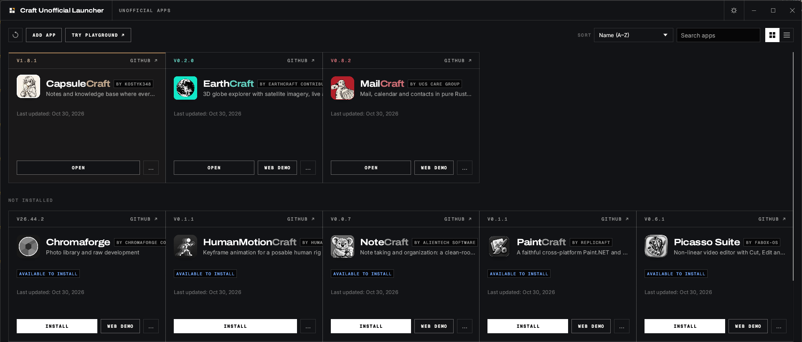

<h1 align="center">Craft Unofficial Launcher</h1>

<p align="center">
  <b>Install and update unofficial Craft-style apps from one place.</b><br>
  Every app describes itself with a <code>craft-app.json</code> in its own releases. The launcher
  checks it, then installs and updates the app like any other.
</p>

<p align="center">
  
  
  
</p>

> [!IMPORTANT]
> **This is not an ArtCraft product.** Craft Unofficial Launcher is an independent fork of
> [ArtCraft Launcher](https://github.com/storytold/craft-launcher). It is not made, endorsed or
> supported by ArtCraft, Storyteller or Learning Machines LLC. For the official Craft App Suite
> (PhotoCraft, FilmCraft, WordCraft…) use [ArtCraft Launcher](https://github.com/storytold/craft-launcher/releases/latest).
> This launcher never lists official apps.



## Why

Many Craft-style apps exist outside the official suite. ArtCraft Launcher picks its community apps
by hand and compiles each one in. This launcher follows the approach described in
[storytold/craft-launcher#989](https://github.com/storytold/craft-launcher/issues/989): an app joins
**as data**, not as code. Nobody has to approve a pull request here for an app to work. It publishes
a descriptor, keeps a fixed release format, and the user adds its repository.

## How it works

1. **The app publishes `craft-app.json`** with every GitHub release, listed in `SHA256SUMS.txt`
   beside packages named `<id>-<version>-<os>-<arch>[-portable].<ext>`. See
   [docs/craft-app-spec.md](docs/craft-app-spec.md).
2. **You add the app.** Choose **Add app** and type `owner/name` (or paste the GitHub link), or
   pick one from the [community index](index/apps.json).
3. **The launcher checks everything before listing it.** It verifies the descriptor and icon
   against the release's checksums, runs the release contract, and refuses anything that claims
   ArtCraft's namespace (`ai.storyteller.*`, Learning Machines LLC, ArtCraft's Apple team, the
   `storytold` account or an official app's name). If something fails, it tells you why.
4. **Identity is pinned.** The app's id, bundle id, Windows publisher and Apple team are recorded
   when you add it. If a later release changes any of them, the launcher refuses that release and
   keeps the version you added until you remove the app and add it again.
5. **Install and update** use the upstream launcher's engine as it is: SHA-256-checked downloads,
   MSI/portable on Windows, DMG on macOS (only when the app names an Apple team the launcher can
   verify), AppImage/deb/rpm/Flatpak/tarball on Linux, tarballs on FreeBSD.

### What the launcher will never do

- Run code from an app's descriptor. It only reads JSON and decodes a PNG.
- Install with elevated rights silently, or update an app without asking.
- Delete an app's files when you remove it from the list. Uninstalling is a separate action.
- Contact ArtCraft's servers. Release information comes straight from each app's GitHub repo.

## For app maintainers

| | |
|---|---|
| Spec | [docs/craft-app-spec.md](docs/craft-app-spec.md) |
| Example descriptor | [`craft-app.json.example`](craft-app.json.example): every field, with the optional ones filled in |
| Starter descriptor | `craft-release-check init --repo owner/name --id myapp --name MyApp` |
| Check a release before upload | `craft-release-check dir dist/ --repo owner/name --tag v1.2.3` |
| Check a published release | `craft-release-check github --repo owner/name` |
| CI | [`.github/actions/craft-release-check`](.github/actions/craft-release-check/action.yml) |
| In-app updates | [`crates/update`](crates/update) (`craft-unofficial-update`): `App::from_embedded(include_str!("../craft-app.json"), "owner/name")` |

If the upstream project doesn't want to adopt the format, a **bridge repo** can: it packages
upstream's builds in the contract's names, attaches `craft-app.json` with `upstream` set to the
source repo, and publishes `SHA256SUMS.txt`.

## Workspace

```text
crates/descriptor     craft-app-descriptor     craft-app.json schema, hostile-input checks, release contract, index (pure, wasm-safe)
crates/release-check  craft-release-check      the CI checker
crates/update         craft-unofficial-update  the app-side updater (fork of craft-libs' craft-update, with per-app identity)
crates/core           launcher core            the runtime catalog, versions, release parsing, asset choice
crates/native         launcher backend         HTTP, the app registry, detection, install
crates/ui-egui        launcher UI              egui, desktop and web
apps/                 desktop and web shells
index/apps.json       the community index (repo names only; listing vouches for nothing)
```

## Build from source

```sh
cargo run -p artcraft-launcher        # the desktop launcher
cargo xtask ci                        # fmt, clippy, tests, wasm check
```

Rust 1.95 or newer. See [AGENTS.md](AGENTS.md) for the project's rules.

## Licence and credits

MIT OR Apache-2.0, like upstream. Built on [storytold/craft-launcher](https://github.com/storytold/craft-launcher)
and [storytold/craft-libs](https://github.com/storytold/craft-libs) (`craft-update`); see
[NOTICE](NOTICE) and [ATTRIBUTION.md](ATTRIBUTION.md). "ArtCraft" and its logos are trademarks of
their owners. This project doesn't use them and isn't affiliated with them.
